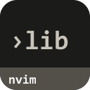
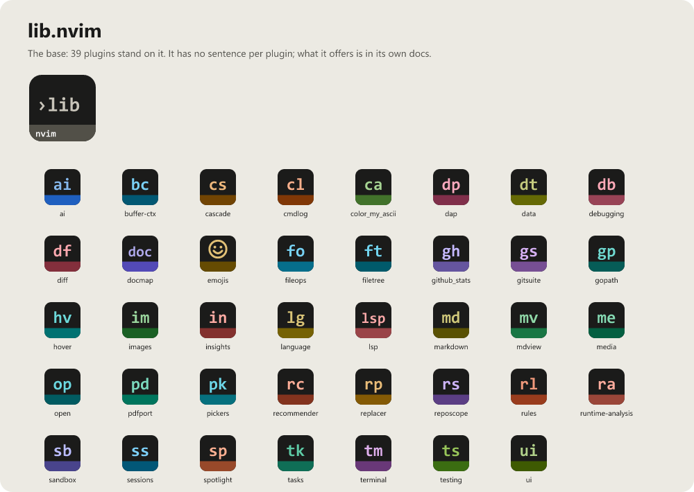

> **Beta stage — active development.** This repository is past its first shape and in
> active use, but the surface is not frozen: breaking changes are still possible. Pin a
> commit or tag if you depend on it.

# lib.nvim

```
  _ _ _                 _
 | (_) |__   _ ____   _(_)_ __ ___
 | | | '_ \ | '_ \ \ / / | '_ ` _ \
 | | | |_) || | | \ V /| | | | | | |
 |_|_|_.__(_)_| |_|\_/ |_|_| |_| |_|
```

[](LICENSE)
[](https://neovim.io)
[](https://www.lua.org)


[](https://github.com/WKDSteve/lib.nvim/actions/workflows/ci.yml)
[](https://wkdsteve.github.io/wkd/p/lib/)

> Part of the [wkd](https://wkdsteve.github.io/wkd/) family — see this plugin's [page](https://wkdsteve.github.io/wkd/p/lib/) on the site.

Reusable Lua and Neovim helpers — one tested base under a whole set of plugins.
Extracted from a private Neovim configuration so that personal plugins can
share a single set of helpers as a dependency instead of each carrying its own
copy. It has **no third-party dependencies** — only `vim` and itself.

---

## Around it

> **[docmap.nvim](https://github.com/WKDSteve/docmap.nvim)** —
> reads and navigates the docs this library's conventions produce; it also holds
> the ecosystem architecture that says what belongs down here.
>
> **[insights.nvim](https://github.com/WKDSteve/insights.nvim)** — static
> analysis of a project from inside the editor, and the largest single consumer
> of the helpers here.
>
> **[runtime-analysis.nvim](https://github.com/WKDSteve/runtime-analysis.nvim)** —
> the runtime counterpart, measuring what was actually called rather than what
> the source says.
>
> Every `StefanBartl/*.nvim` plugin depends on this one. The direction never
> reverses: nothing here may require any of them.

---

## Documentation

Start at the [documentation index](docs/README.md) — `lib.nvim` describes the
same module at several depths, and the index says which one answers which
question.

### The Basics

- [Requirements](docs/installation.md#requirements) — Neovim version, and the (lack of) third-party dependencies.
- [Installation](docs/installation.md) — plugin dependency vs. config-wide bootstrap.
- [Quickstart](docs/quickstart.md) — requiring a module directly vs. through the aggregator.

### Reference

- [Namespaces & modules](docs/modules.md) — every `lib.lua.*` / `lib.nvim.*` module, one line each, with links to per-module docs.
- [Design pattern collection](docs/patterns.md) — GoF and common modern patterns as reference modules (`lib.lua.patterns.*`, `lib.nvim.patterns.*`) or pointers to the feature module that already is the pattern.
- [API reference](docs/API/README.md) — function signatures across a whole theme, without opening dozens of files.
- [Data classes](lua/lib/nvim/data_classes/README.md) — `lib.nvim.data_classes`: may this area or repository leave the machine? Reads the per-device `areas.json` of the desktop apps (tasks-desktop) fail-closed; no file, a broken file or no entry is `unclassified`, released for nothing.
- [Configuration](docs/configuration.md) — the aggregator strategies and their defaults.
- [Bindings](docs/BINDINGS.md) — the deliberately small user command and autocommand surface, including `:Lib deps` and `:Lib helptags`.

### The Rest

- [Features](docs/FEATURES/README.md) — cross-cutting capabilities, written up per theme: why each exists and when to reach for it.
- [Examples](docs/EXAMPLES/README.md) — runnable scenarios for the larger modules.
- [Guides](docs/guides/README.md) — ecosystem-wide findings this library absorbed so nobody has to re-solve them.
- [Architecture](docs/architecture.md) — the `lib.lua.*` / `lib.nvim.*` split and the rule behind it.
- [Workflow](docs/WORKFLOW.md) — building a plugin on top: which module for which job.
- [Health check](docs/health.md) — what `:checkhealth lib` reports.
- [Contributing](docs/CONTRIBUTING.md) — ground rules, repository layout, and how to add a module.
- [Templates](templates/README.md) — resolving `lib.nvim` in a dependent plugin's own headless test suite, and the scripts of a plugin's command line (`cli_script.lua`) and machine contract (`contract_host.lua`).
- [Feedback](https://github.com/WKDSteve/lib.nvim/issues) — bugs, feature requests and usage questions; broader discussion in [Discussions](https://github.com/WKDSteve/lib.nvim/discussions).

`:help lib.nvim` is the same reference inside the editor — see
[docs/help.md](docs/help.md) for how the tags are generated.

Not in this repository: [ecosystem architecture](https://github.com/WKDSteve/docmap.nvim/blob/main/docs/ECOSYSTEM.md)
— where docs, static analysis and runtime each belong across the four pieces
this library is the bottom of (`lib.nvim`, `docmap.nvim`,
`runtime-analysis.nvim`, `mdview.nvim`), and the rule that decides what moves
down here and what does not.

---

## License

[](LICENSE)

lib.nvim is released under the [MIT License](https://opensource.org/licenses/MIT).

<!-- connections:begin (written by the app-icons tool of the workshop; change integrations.json there, not this block) -->
## Connections



**Uses**

- [docmap.nvim](https://github.com/WKDSteve/docmap.nvim): A developer tool of lib.nvim (`pattern_usage`) reads a module map that docmap.nvim made (`docmap.core.artifact`). ([picture](assets/graphs/pair/lib.nvim--docmap.nvim.png))
- [images.nvim](https://github.com/WKDSteve/images.nvim): The image preview of lib.nvim (`image_preview`) detects images.nvim as its provider. ([picture](assets/graphs/pair/lib.nvim--images.nvim.png))
- [runtime-analysis.nvim](https://github.com/WKDSteve/runtime-analysis.nvim): The telemetry wrapper of lib.nvim (`strategies.telemetry_wrap`) reports to runtime-analysis.nvim (`runtime-analysis.telemetry`). ([picture](assets/graphs/pair/lib.nvim--runtime-analysis.nvim.png))
- [ui.nvim](https://github.com/WKDSteve/ui.nvim): The popup notifications of lib.nvim use `ui.kit.toast` of ui.nvim when it is installed. ([picture](assets/graphs/pair/lib.nvim--ui.nvim.png))

**Used by**

- [ai.nvim](https://github.com/WKDSteve/ai.nvim): calls it
- [buffer-ctx.nvim](https://github.com/WKDSteve/buffer-ctx.nvim): calls it
- [cascade.nvim](https://github.com/WKDSteve/cascade.nvim): calls it
- [cmdlog.nvim](https://github.com/WKDSteve/cmdlog.nvim): calls it
- [color_my_ascii.nvim](https://github.com/WKDSteve/color_my_ascii.nvim): calls it
- [dap.nvim](https://github.com/WKDSteve/dap.nvim): calls it
- [data.nvim](https://github.com/WKDSteve/data.nvim): calls it
- [debugging.nvim](https://github.com/WKDSteve/debugging.nvim): calls it
- [diff.nvim](https://github.com/WKDSteve/diff.nvim): calls it
- [docmap.nvim](https://github.com/WKDSteve/docmap.nvim): calls it
- [emojis.nvim](https://github.com/WKDSteve/emojis.nvim): calls it
- [fileops.nvim](https://github.com/WKDSteve/fileops.nvim): calls it
- [filetree.nvim](https://github.com/WKDSteve/filetree.nvim): calls it
- [github_stats.nvim](https://github.com/WKDSteve/github_stats.nvim): calls it
- [gitsuite.nvim](https://github.com/WKDSteve/gitsuite.nvim): calls it
- [gopath.nvim](https://github.com/WKDSteve/gopath.nvim): calls it
- [hover.nvim](https://github.com/WKDSteve/hover.nvim): calls it
- [images.nvim](https://github.com/WKDSteve/images.nvim): calls it
- [insights.nvim](https://github.com/WKDSteve/insights.nvim): calls it
- [language.nvim](https://github.com/WKDSteve/language.nvim): calls it
- [lsp.nvim](https://github.com/WKDSteve/lsp.nvim): calls it
- [markdown.nvim](https://github.com/WKDSteve/markdown.nvim): calls it
- [mdview.nvim](https://github.com/WKDSteve/mdview.nvim): calls it
- [media.nvim](https://github.com/WKDSteve/media.nvim): uses it when installed
- [open.nvim](https://github.com/WKDSteve/open.nvim): calls it
- [pdfport.nvim](https://github.com/WKDSteve/pdfport.nvim): calls it
- [pickers.nvim](https://github.com/WKDSteve/pickers.nvim): calls it
- [recommender.nvim](https://github.com/WKDSteve/recommender.nvim): calls it
- [replacer.nvim](https://github.com/WKDSteve/replacer.nvim): calls it
- [reposcope.nvim](https://github.com/WKDSteve/reposcope.nvim): calls it
- [rules.nvim](https://github.com/WKDSteve/rules.nvim): calls it
- [runtime-analysis.nvim](https://github.com/WKDSteve/runtime-analysis.nvim): calls it
- [sandbox.nvim](https://github.com/WKDSteve/sandbox.nvim): calls it
- [sessions.nvim](https://github.com/WKDSteve/sessions.nvim): calls it
- [spotlight.nvim](https://github.com/WKDSteve/spotlight.nvim): calls it
- [tasks.nvim](https://github.com/WKDSteve/tasks.nvim): calls it
- [terminal.nvim](https://github.com/WKDSteve/terminal.nvim): calls it
- [testing.nvim](https://github.com/WKDSteve/testing.nvim): calls it
- [ui.nvim](https://github.com/WKDSteve/ui.nvim): calls it
- every plugin that stands on it (39): [ai.nvim](https://github.com/WKDSteve/ai.nvim), [buffer-ctx.nvim](https://github.com/WKDSteve/buffer-ctx.nvim), [cascade.nvim](https://github.com/WKDSteve/cascade.nvim), [cmdlog.nvim](https://github.com/WKDSteve/cmdlog.nvim), [color_my_ascii.nvim](https://github.com/WKDSteve/color_my_ascii.nvim), [dap.nvim](https://github.com/WKDSteve/dap.nvim), [data.nvim](https://github.com/WKDSteve/data.nvim), [debugging.nvim](https://github.com/WKDSteve/debugging.nvim), [diff.nvim](https://github.com/WKDSteve/diff.nvim), [docmap.nvim](https://github.com/WKDSteve/docmap.nvim), [emojis.nvim](https://github.com/WKDSteve/emojis.nvim), [fileops.nvim](https://github.com/WKDSteve/fileops.nvim), [filetree.nvim](https://github.com/WKDSteve/filetree.nvim), [github_stats.nvim](https://github.com/WKDSteve/github_stats.nvim), [gitsuite.nvim](https://github.com/WKDSteve/gitsuite.nvim), [gopath.nvim](https://github.com/WKDSteve/gopath.nvim), [hover.nvim](https://github.com/WKDSteve/hover.nvim), [images.nvim](https://github.com/WKDSteve/images.nvim), [insights.nvim](https://github.com/WKDSteve/insights.nvim), [language.nvim](https://github.com/WKDSteve/language.nvim), [lsp.nvim](https://github.com/WKDSteve/lsp.nvim), [markdown.nvim](https://github.com/WKDSteve/markdown.nvim), [mdview.nvim](https://github.com/WKDSteve/mdview.nvim), [media.nvim](https://github.com/WKDSteve/media.nvim), [open.nvim](https://github.com/WKDSteve/open.nvim), [pdfport.nvim](https://github.com/WKDSteve/pdfport.nvim), [pickers.nvim](https://github.com/WKDSteve/pickers.nvim), [recommender.nvim](https://github.com/WKDSteve/recommender.nvim), [replacer.nvim](https://github.com/WKDSteve/replacer.nvim), [reposcope.nvim](https://github.com/WKDSteve/reposcope.nvim), [rules.nvim](https://github.com/WKDSteve/rules.nvim), [runtime-analysis.nvim](https://github.com/WKDSteve/runtime-analysis.nvim), [sandbox.nvim](https://github.com/WKDSteve/sandbox.nvim), [sessions.nvim](https://github.com/WKDSteve/sessions.nvim), [spotlight.nvim](https://github.com/WKDSteve/spotlight.nvim), [tasks.nvim](https://github.com/WKDSteve/tasks.nvim), [terminal.nvim](https://github.com/WKDSteve/terminal.nvim), [testing.nvim](https://github.com/WKDSteve/testing.nvim), [ui.nvim](https://github.com/WKDSteve/ui.nvim)
<!-- connections:end -->
